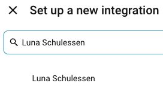

# Luna Schulessen für Home Assistant

[English documentation](README.md)


Diese benutzerdefinierte Home-Assistant-Integration zeigt bestätigte Schulessen-Bestellungen aus dem [Luna-Elternportal](https://bestellen.luna.de/). Sie liest den aktuellen und den nächsten Monat beim Start und danach alle zwei Stunden. Die Integration ist ein unabhängiges Projekt.

## Voraussetzungen

- Getestet mit Home Assistant Core 2026.11.1.
- Ein Luna-Elternkonto mit genau einem Schulessen-Vertrag.
- Home Assistant muss `bestellen.luna.de` per HTTPS erreichen können.

## Installation

1. Lade das Repository über **Code → Download ZIP** herunter und entpacke es.
2. Kopiere den ganzen Ordner `custom_components/luna_schulessen` in das Home-Assistant-Konfigurationsverzeichnis. Auf Home Assistant OS ist der Zielpfad `/config/custom_components/luna_schulessen`.
3. Starte Home Assistant Core neu.
4. Öffne **Einstellungen → Geräte & Dienste → Integration hinzufügen** und wähle **Luna Schulessen**.
5. Gib deinen Luna-Benutzernamen oder deine E-Mail-Adresse und dein Luna-Passwort ein. Home Assistant speichert die Zugangsdaten im Integrationseintrag und verwendet sie für die Anmeldung per HTTPS am Luna-Portal.




## Entitäten

Die IDs sind die Vorschläge von Home Assistant. Deine Instanz kann bei einem Namenskonflikt ein Suffix vergeben.

| Entität | Bedeutung |
| --- | --- |
| `calendar.luna_schulessen` | Bestätigte Bestellungen als ganztägige Termine. Änderungen erscheinen nach dem nächsten erfolgreichen Abruf. |
| `binary_sensor.luna_schulessen_nachster_monat_buchbar` | `on`, sobald Luna für mindestens einen Tag im nächsten Monat ein Menü zur Auswahl freigibt. |
| `sensor.luna_schulessen_nachster_tag_ohne_auswahl` | Datum des ersten künftigen Tags ohne Auswahl, für den Luna ein buchbares Menü oder einen Schließhinweis anzeigt. |

Der Binärsensor enthält `monat` im Format `JJJJ-MM`, `buchbare_tage` und `tage_ohne_auswahl`. Die letzte Zahl zählt nur buchbare Tage ohne bestätigte Bestellung.

Der Datumssensor enthält `buchbar`, `ferien`, `luna_hinweis` sowie `naechster_buchbarer_tag_ohne_auswahl`. `luna_hinweis` übernimmt Lunas Bezeichnung, zum Beispiel „Weihnachtsferien“. Das zusätzliche Datumsattribut ist leer, wenn in den abgefragten Monaten kein künftiger buchbarer Tag ohne Auswahl liegt.

## Beispiel für eine Wochenliste

Diese Karte zeigt im Dashboard die Bestellungen der nächsten sieben Tage.

```yaml
type: calendar
title: Bestelltes Schulessen
initial_view: listWeek
entities:
  - calendar.luna_schulessen
```

Für eine Erinnerung bei Freischaltung des nächsten Monats kannst du den Wechsel des Binärsensors auf `on` als Auslöser und `tage_ohne_auswahl > 0` als Bedingung verwenden. Für eine Erinnerung vor dem nächsten offenen Essen eignet sich `naechster_buchbarer_tag_ohne_auswahl`, weil es Schließtage ohne buchbares Menü überspringt.

## Fehlerbehebung

- **Anmeldung abgelehnt** – Prüfe die Zugangsdaten und teste sie im Luna-Elternportal. Bei geändertem Passwort bietet Home Assistant eine erneute Anmeldung an.
- **Bestellübersicht konnte nicht gelesen werden** – Prüfe, ob das Elternportal genau einen Schulessen-Vertrag enthält und Home Assistant das Portal erreichen kann.
- **Sensoren sind nicht verfügbar** – Prüfe im Home-Assistant-Protokoll Meldungen zur Integration `luna_schulessen`. Kalender und Auswahlstatus verwenden unterschiedliche Ansichten des Luna-Portals. Eine Änderung am Portal kann eine Anpassung der Integration erforderlich machen.
