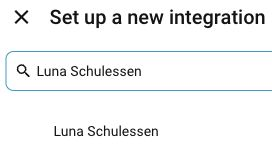

# Luna Schulessen for Home Assistant

[Deutsche Anleitung](README.de.md)

Luna Schulessen is a custom integration for the [Luna school lunch parent portal](https://bestellen.luna.de/). It shows confirmed lunch orders in a Home Assistant calendar and provides sensors for next month's booking availability, upcoming dates without selections, and school holidays reported by Luna. It reads the current and following month at startup and refreshes every two hours.

This is an independent integration. Version **0.1** was tested with Home Assistant Core **2026.11.1**.

## Install and add to Home Assistant

You need a Luna parent account with exactly one school lunch contract. Your Home Assistant instance needs HTTPS access to `bestellen.luna.de`.

1. On this repository's GitHub page, select **Code → Download ZIP** and extract the archive.
2. Copy `custom_components/luna_schulessen` from the archive into your Home Assistant configuration directory. On Home Assistant OS, the manifest should end up at `/config/custom_components/luna_schulessen/manifest.json`.
3. Restart Home Assistant Core.
4. Open **Settings → Devices & services → Add integration**, search for **Luna Schulessen**, and select it.
5. Enter your Luna username or email address and password. Home Assistant stores the credentials in the integration entry and sends them to the Luna portal over HTTPS when signing in.



The Luna icon appears on the installed integration page.


## Entities

These are the default entity IDs. Home Assistant may append a suffix if an ID is already in use.

| Entity | What it shows |
| --- | --- |
| `calendar.luna_schulessen` | Confirmed lunch orders as all-day events. Changes and cancellations appear after the next successful refresh. |
| `binary_sensor.luna_schulessen_nachster_monat_buchbar` | `on` when Luna offers a bookable menu on at least one day next month. |
| `sensor.luna_schulessen_nachster_tag_ohne_auswahl` | The first future date without a selection for which Luna lists a bookable menu or a closure notice. |

The binary sensor exposes `monat` (`YYYY-MM`), `buchbare_tage` (bookable days), and `tage_ohne_auswahl` (bookable days without a confirmed order). For a reminder when next month's menu opens, use the transition to `on` as the trigger and check that `tage_ohne_auswahl` is greater than zero.

The date sensor exposes `buchbar` (bookable), `ferien` (school holiday), `luna_hinweis` (Luna's original notice), and `naechster_buchbarer_tag_ohne_auswahl` (the next bookable date without an order). Use this last attribute for reminders because it skips closures without a bookable menu. It is empty when there are no such dates in the months checked.

## Weekly dashboard card

Add a Calendar card with this configuration to show the next seven days.

```yaml
type: calendar
title: School lunch
initial_view: listWeek
entities:
  - calendar.luna_schulessen
```

## Troubleshooting

- **Sign-in was rejected** — Test your credentials in the Luna parent portal. If you changed your password, use Home Assistant's reauthentication flow.
- **The order overview could not be read** — Check that your parent account shows one school lunch contract and that Home Assistant can reach the Luna portal.
- **Availability sensors are unavailable** — Check the Home Assistant logs for `luna_schulessen`. Luna's order overview and booking calendar are separate views, so one can be unavailable while the other is working.
